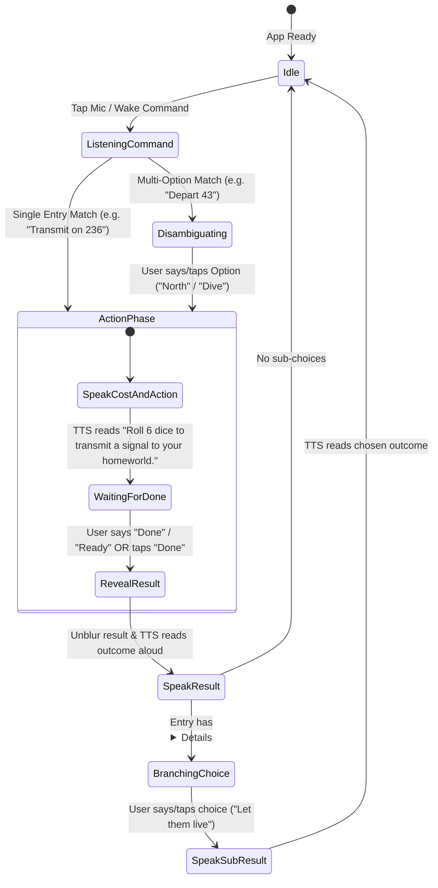

# Vantage Voice & Storybook Companion App — Architecture & Implementation Plan

> **For Subagents & Contributors**: This document is the single source of truth for the architecture, dataset schema, voice state machine, and module contracts of the Vantage Companion App in `d:\CODE PROJECTS\vantageapp`. Read this before implementing or modifying modules.

---

## 1. Executive Summary & Architecture Strategy

This application is a **100% Web-First Installable Progressive Web App (PWA)** (with optional Capacitor native packaging) designed for the board game **Vantage** by Stonemaier Games. It works **completely offline (camping / Airplane Mode)** on both Android and iOS.

### Core Pillars
1. **100% Offline Installable PWA**:
   - Uses Vite + TypeScript + `vite-plugin-pwa` (Workbox) and `CacheStorage` / `IndexedDB` to store the entire UI, SVG icons, Book of Secrets images, the complete `stories.json` database (~6,262 entries), and the offline speech model locally on the device.
2. **Local OS Text-to-Speech (`window.speechSynthesis`)**:
   - Uses the phone's built-in system voices offline on both Android and iOS with zero extra bundle size.
   - Includes an automatic **audio-unlock handler** on the first user interaction so hands-free TTS responses work seamlessly on iOS Safari and Android Chrome.
3. **Dual-Engine Local Speech-to-Text (STT)**:
   - **Engine A: In-Browser Offline WASM Engine (`vosk-browser`) — Camping / Airplane Mode Ready**:
     - Runs the lightweight `vosk-model-small-en-us-0.15` (~40 MB, cached locally in `IndexedDB` / `CacheStorage`) directly inside the browser via WebAssembly + Web Audio API.
     - **Grammar-Constrained Recognition**: Because we know every word in *Vantage* (the 8 book names, all ~250 action verbs from `stories.json`, numbers `zero`–`thousand`, directions, choice words, and `"done"`), we pass a **restricted vocabulary grammar** to the recognizer. This makes offline recognition fast, battery-friendly, and immune to mishearing out-of-vocabulary words.
     - **Silent Continuous Listening**: Unlike mobile `webkitSpeechRecognition` (which beeps and times out after 5 seconds of silence while rolling dice), the in-browser WASM engine listens silently for 30+ seconds while players roll and resolve dice until they say **"Done"**.
   - **Engine B: Browser Native Web Speech API (`webkitSpeechRecognition` / `SpeechRecognition`)**:
     - Available as an instant zero-download toggle or fallback before the offline voice model finishes its one-time local cache download.

---

## 2. Dataset & Domain Specification (`public/data/stories.json`)

The dataset is sourced from `https://vantage.rulepop.com/assets/stories-CU1EyUlD.json` and stored locally at `public/data/stories.json`.

### Key Format
- **Total Keys**: **6,262 keys** (`Record<string, StoryVariant | StoryVariant[]>`)
- Each key consists of a **1-letter book prefix** followed by the **unpadded entry number** (1 to 4 digits, e.g., `e236`, `d43`, `s1`, `m1016`):
  - `m` = **Move** (Blue)
  - `l` = **Look** (Purple)
  - `e` = **Engage** (Teal/Green)
  - `h` = **Help** (Orange)
  - `t` = **Take** (Yellow)
  - `o` = **Overpower** (Red)
  - `d` = **Depart** (Dark Blue — directional movement N/E/S/W)
  - `s` = **Book of Secrets** (145 entries, including puzzle solutions and `/figs/bos*.webp` images)

### Entry Object Schema (`StoryRawEntry`)
In `stories.json`, a key maps to either a **single object** OR an **array of objects** (437 keys have multiple options: 422 `d*` Depart keys and 15 `m*` Move keys):

```ts
export type BookPrefix = 'm' | 'l' | 'e' | 'h' | 't' | 'o' | 'd' | 's';

export type BookName =
  | 'move'
  | 'look'
  | 'engage'
  | 'help'
  | 'take'
  | 'overpower'
  | 'depart'
  | 'secret';

export interface StoryRawVariant {
  option?: string;      // Present on multi-option entries, e.g. "N", "E", "SURFACE", "DIVE"
  direction?: string;   // Present on depart entries, e.g. "N", "E", "S", "W", or custom text
  region?: string;      // Present on some look entries, e.g. "A".."F"
  cost?: number;        // Challenge dice cost (1..8)
  action?: string;      // HTML string, e.g. "<span class='engage'>TRANSMIT</span> a signal to your homeworld"
  result?: string;      // HTML string with <p>, <span class='loc-num'>, <span class='card-num'>, and optional <details><summary>Choice</summary><div>...</div></details>
  obscure?: boolean;    // Defaults to true; false on entries like s1 where result is not blurred
}
```

### Example Entries from `stories.json`
- **`e236` (Single Entry)**:
  ```json
  {
    "cost": 6,
    "action": "<span class='engage'>TRANSMIT</span> a signal to your homeworld",
    "result": "<p>The early days of basic training finally prove useful as you apply the fundamentals of radio signals to the tower. You tap into the tower’s system to send a quick burst that your homeworld should recognize if anyone’s listening. Your rescuers will need to triangulate the signal to find you, but this is a good start. Gain destiny <span class='card-num'>1598</span> if you do not already have it. Either way, add 1 signal token to that destiny.</p>"
  }
  ```
- **`o236` (Entry with Branching `<details>` Choices in `result`)**:
  ```json
  {
    "cost": 4,
    "action": "<span class='overpower'>STUN</span> a sentient as it emerges from the tower",
    "result": "<p>A translucent pink sentient blinks into existence from one of the lights on the tower. You catch it off guard, slamming it to the ground. They beg for you to let them live, offering a lesson in magic in exchange. Choose one:</p><details><summary>Let them live</summary><div><p>Gain lesson <span class='card-num'>1424</span>.</p></div></details><details><summary>Finish them</summary><div><p>The allure of the sentient’s life force is too much for you to resist. They blink out of existence, and you lose 1 morale and gain 2 health.</p></div></details>"
  }
  ```
- **`d43` (Multi-Option Array Entry)**:
  ```json
  [
    {
      "option": "E",
      "direction": "E",
      "cost": 5,
      "action": "<span class='move'>ENTER</span> east into a glowing door",
      "result": "<p>You step into an elevator...</p>"
    },
    {
      "option": "N",
      "direction": "N",
      "cost": 2,
      "action": "<span class='move'>EVADE</span> north around the nest...",
      "result": "<p>Your augsuit catches on the nest...</p>"
    }
  ]
  ```

### Reverse Action Verb Index ("Transmit on 236")
Every location/card number (e.g., `236`) has up to 8 keys (`m236`, `l236`, `e236`, `h236`, `t236`, `o236`, `d236`, `s236`).
At startup, `storyDb.ts` parses every entry's `action` HTML to extract the uppercase/span action verb (e.g., `TRANSMIT`, `WADE`, `CRAFT`, `STUDY`, `SCALE`, `STUN`, `HACK`) and builds:
1. **Per-Number Verb Map**: `number -> Array<{ key, prefix, bookName, verb, option, direction, variant }>`
   - For `236`:
     - `"scale"` / `"move"` $\rightarrow$ `m236`
     - `"study"` / `"look"` $\rightarrow$ `l236`
     - `"transmit"` / `"engage"` $\rightarrow$ `e236`
     - `"craft"` / `"help"` $\rightarrow$ `h236`
     - `"hack"` / `"take"` $\rightarrow$ `t236`
     - `"stun"` / `"overpower"` $\rightarrow$ `o236`
     - `"wade"` / `"depart"` / `"north"` $\rightarrow$ `d236`
2. **Global Vocabulary Set**: Set of all unique action verbs, book names, directions, and choice keywords across all 6,262 entries to feed into the Vosk grammar and fuzzy matcher.

---

## 3. Voice Interaction & State Machine



### Detailed Walkthrough of the Flow ("Transmit on 236")
1. **Command Phase (`ListeningCommand`)**:
   - User taps the microphone (or uses hands-free mode) and says: *"Transmit on 236"* (also supports *"two thirty six"*, *"two three six"*, *"engage 236"*, *"236 transmit"*).
2. **Disambiguation Phase (`Disambiguating` — Only when needed)**:
   - If the user says *"Depart 43"* and `d43` has both `East (ENTER)` and `North (EVADE)` options (and the user didn't already say *"Depart North 43"* or *"Evade on 43"*), the app displays the radio options and asks: *"Multiple options for Depart 043: East, Enter; or North, Evade. Which one?"*
3. **Action Phase (`ActionPhase` — Spoiler-Protected)**:
   - UI displays **Engage 236**:
     - Shows the **Action Banner**: `[Cost: 6] TRANSMIT a signal to your homeworld`
     - Shows the **Result Box**: **Blurred / Obscured** (`filter: blur(8px)`) with a prominent **"DONE — Reveal & Read Result"** button.
   - **TTS Speaks**: *"Roll 6 dice to transmit a signal to your homeworld."* (If `cost` is `1`: *"Roll 1 die to..."*; if `cost` is undefined/null: reads the action text directly; if `obscure === false` such as `s1`, proceeds straight to reading the entry).
   - **Auto-Listen for "Done" (`WaitingForDone`)**: Immediately after TTS finishes speaking the prompt, the STT engine listens for confirmation keywords (`"done"`, `"ready"`, `"read"`, `"reveal"`, `"continue"`, `"finished"`, `"okay"`, or `"cancel"` / `"back"`).
4. **Result Phase (`SpeakResult`)**:
   - User says **"Done"** (or taps the **Done** button).
   - The main result text unblurs smoothly. (Nested `<details>` sub-choices remain collapsed/spoiler-protected until chosen!)
   - **TTS Speaks**: *"The early days of basic training finally prove useful as you apply the fundamentals of radio signals to the tower... Gain destiny 1598 if you do not already have it. Either way, add 1 signal token to that destiny."*
5. **Branching Choices Phase (`BranchingChoice` — e.g., Overpower 236 "Stun on 236")**:
   - If the result HTML contains `<details><summary>...</summary><div>...</div></details>` blocks:
   - TTS reads the intro paragraph, then announces the choices: *"Option 1: Let them live. Option 2: Finish them. Which do you choose?"*
   - STT listens for the option summary text or option number (*"Let them live"*, *"Finish them"*, *"Option 1"*, *"First one"*), opens only that `<details>` block, unblurs its inner content, and reads that specific outcome aloud.

---

## 4. Natural Language & Speech Processing Specifications

### Spoken Number Normalization (`src/speech/voiceParser.ts`)
Must convert any combination of spoken number words or digits into the canonical integer string (`"1"`..`"9999"`):
- Single digits sequence: `"two three six"` $\rightarrow$ `236`, `"zero four one"` / `"oh four one"` $\rightarrow$ `41`
- Compound numbers: `"two thirty six"` $\rightarrow$ `236`, `"two hundred and thirty six"` $\rightarrow$ `236`, `"fourteen twenty four"` $\rightarrow$ `1424`, `"one thousand five hundred ninety eight"` $\rightarrow$ `1598`
- Homophones for numbers: `"to"` / `"too"` $\rightarrow$ `2`, `"for"` / `"fore"` $\rightarrow$ `4`, `"won"` $\rightarrow$ `1`, `"ate"` $\rightarrow$ `8`, `"oh"` $\rightarrow$ `0`.

### Fuzzy Verb & Book Matching
- Once the entry number (e.g., `236`) is extracted from the transcript, look up all available entries for `236` in `storyDb`.
- Match the remaining words in the transcript against:
  1. Exact or fuzzy match on the **action verb** for that number (e.g., `"transmit"` matches `e236`'s `TRANSMIT`; `"evade"` matches `d43`'s `N` variant `EVADE`).
  2. Exact or fuzzy match on the **book name** (`move`, `look`, `engage`, `help`, `take`, `overpower`, `depart`, `secret` / `book of secrets`).
  3. Cardinal direction (`north`, `south`, `east`, `west`) for `depart` entries.
- Uses Levenshtein distance / normalized similarity so minor STT variations (e.g., `"transmits"`, `"transit"`, `"stunning"`, `"studying"`) still resolve accurately to the right action on that location.

### TTS Natural Speech Formatting (`src/speech/ttsFormatter.ts`)
- **Action Prompt Formatter**:
  - Strips HTML tags (`<span class='engage'>TRANSMIT</span> a signal...` $\rightarrow$ `"transmit a signal..."`).
  - Expands direction codes if present (`N` $\rightarrow$ `"north"`, `E` $\rightarrow$ `"east"`, `S` $\rightarrow$ `"south"`, `W` $\rightarrow$ `"west"`).
  - If `cost > 0`: formats as `"Roll ${cost} ${cost === 1 ? 'die' : 'dice'} to ${actionText}."`
  - If no cost: formats as `"${actionText}."`
- **Result Text Formatter**:
  - Parses the HTML DOM of `result`.
  - Extracts the main body paragraphs (everything outside `<details>`) and cleans up symbols (e.g. `$15` $\rightarrow$ `"15 coins"`, `/` between skills like `move/look/engage (058)` $\rightarrow$ `"move, look, or engage: 058"`).
  - Extracts each `<details>` block into `{ summary: string, bodyHtml: string, bodySpeech: string }[]` so main text and branching choices are handled cleanly.

---

## 5. Project Directory Structure & Module Contracts

```text
d:\CODE PROJECTS\vantageapp\
├── PLAN.md                     # This architecture & implementation specification
├── README.md                   # User & developer guide
├── index.html                  # App shell + inline SVG sprite sheet from Rulepop
├── package.json                # Vite + TypeScript + vite-plugin-pwa + vosk-browser + Capacitor
├── tsconfig.json               # TypeScript configuration
├── vite.config.ts              # Vite + vite-plugin-pwa configuration for 100% offline caching
├── capacitor.config.ts         # Capacitor configuration for optional Android/iOS native builds
├── public/
│   ├── manifest.webmanifest    # Installable PWA manifest
│   ├── icons/                  # App icons & UI assets
│   ├── data/
│   │   └── stories.json        # Local 6,262-entry storybook database
│   └── figs/                   # Local Book of Secrets solution images (bos*.webp)
└── src/
    ├── main.ts                 # App initialization & UI binding
    ├── styles/
    │   └── main.css            # Rulepop-inspired styling, book color themes, spoiler blur, voice dock
    ├── data/
    │   ├── types.ts            # Shared TypeScript interfaces
    │   └── storyDb.ts          # Loads stories.json, builds Reverse Action Verb Index & vocabulary
    ├── speech/
    │   ├── ttsFormatter.ts     # Converts HTML entries into natural spoken prompts & choice lists
    │   ├── voiceParser.ts      # Parses spoken numbers, "transmit on 236", "done", and choices
    │   └── speechService.ts    # Unified TTS + Dual-Engine STT (Vosk Offline WASM + Web Speech API)
    └── ui/
        ├── svgIcons.ts         # Helper for rendering Rulepop SVG icons (#i-move, #i-cost-6, etc.)
        ├── lookupPad.ts        # 8-book selector + 0-9 numpad controller + text search bar
        ├── storyView.ts        # Spoiler-protected entry viewer, "Done" trigger & branching choices
        └── voiceController.ts  # State machine coordinating STT -> Lookup -> TTS -> "Done" -> TTS
```

---

## 6. Parallel Work Breakdown for Subagents

1. **Workstream 1: Project Scaffolding & Local Assets (`package.json`, `vite.config.ts`, `public/data/stories.json`, `public/figs/*`, `index.html`)**
   - Initialize Vite + TypeScript project, download `stories.json`, extract SVG symbols (`#i-move`, `#key-move`, `#i-cost-1`..`8`, etc.) and Book of Secrets `bos*.webp` figures from `vantage.rulepop.com` so the app has 100% local assets.
2. **Workstream 2: Data Layer, Reverse Action Index & NLP Parser (`src/data/*`, `src/speech/ttsFormatter.ts`, `src/speech/voiceParser.ts`)**
   - Implement `types.ts`, `storyDb.ts`, `ttsFormatter.ts`, and `voiceParser.ts` with comprehensive unit tests covering `"transmit on 236"`, spoken number variations, multi-option entries (`d43`, `m51`), and branching `<details>` choices (`o236`).
3. **Workstream 3: Speech Service (`src/speech/speechService.ts`)**
   - Implement local TTS (`window.speechSynthesis` with iOS/Android audio unlock, voice selection, rate control) and Dual-Engine STT:
     - Browser Web Speech API (`SpeechRecognition` / `webkitSpeechRecognition`)
     - Offline WASM Engine (`vosk-browser` loading `vosk-model-small-en-us-0.15.tar.gz` with local caching, download progress UI, and Vantage grammar constraint).
4. **Workstream 4: UI Components & Voice State Machine (`src/ui/*`, `src/styles/main.css`, `src/main.ts`)**
   - Build the Rulepop-inspired Storybook Lookup grid, Numpad, Voice Control Dock, Offline Model Manager modal, and Spoiler-Protected Story Viewer wired to the complete voice interaction loop.
5. **Workstream 5: Verification, Build & Git Commits**
   - Run TypeScript typechecking, unit tests, production PWA bundle build (`npm run build`), verify Service Worker precaching, and commit cleanly to git.

---

## 7. Game Setup Cards (`000` & `001`), Enhanced "Repeat" Command & Future Destination Tracking Roadmap

### 7.1 Starting Game Setup Cards (`000` and `001`)
- **Card / Location `000` (Back of the Book of Vantages — Spaceship Orbit Setup)**:
  - Stored as `s0` in `stories.json` and accessible via voice (*"Location 000"*, *"Card 000"*, *"Setup"*, *"Start game"*), numpad (`0` or `000`), or a dedicated **"🚀 Start New Game (000 & 001)"** quick-action button on the Lookup Pad.
  - **Step 1**: *"Weeks after receiving a mysterious signal from 'the Traveler,' your ship arrives in the orbit of an uncharted planet. Create the total challenge dice pool using 8 dice plus 2 per player."*
  - **Step 2**: *"Each player gains a different skill (select or randomize) and its matching character card: Move (1435), Look (1436), Engage (1437), Help (1438), Take (1439), or Overpower (1440). Place the card in the middle of your grid and gain its 'when placed' benefit (2 boost)."*
  - **Step 3**: *"Each player sets the Time, Morale, and Health trackers matching their character color to: 3 (Brazen), 4 (Daring — recommended for first game), 5 (Practical), or 6 (Cautious)."*
  - **Step 4**: *"The first player gains 2 skills at random and places the matching mission in the center; they may reroll pairs to get an easier mission:"*
    - Displays the complete **21-Mission Dice Pair Lookup Table** (`1577`–`1597`) and a direct **"Continue to Location 001 →"** button.
- **Card / Location `001` (Back of the Book of Secrets — Escape Pods)**:
  - Stored as `s1` in `stories.json` (`"The ship malfunctions! You have mere seconds to escape..."`), assigning each player their Escape Pod location (`002` Move, `003` Look, `004` Engage, `005` Help, `006` Take, `007` Overpower).

### 7.2 Enhanced "Repeat" Voice Keyword (`pre-done` & `post-done`)
- Saying **"Repeat"** (or *"Say again"*, *"Repeat that"*, *"Read again"*, *"Repeat action"*, *"Repeat result"*) works at every stage of an entry:
  1. **Pre-Done (`WAITING_FOR_DONE`)**: Repeats the spoken cost & action prompt (e.g., *"Roll 6 dice to transmit a signal to your homeworld"*) and resumes listening for *"Done"*.
  2. **Post-Done (`IDLE` / `LISTENING_COMMAND` / `BRANCHING_CHOICE` while a result is revealed)**:
     - Repeats the full revealed post-done result text (and if a branching choice was selected, repeats that chosen branch outcome, or if waiting at a branching choice prompt, repeats the main result + branch options).
     - Also supports explicit voice phrases like **"Repeat action"** / **"Repeat prompt"** (to re-hear the pre-done text even after revealing) or **"Repeat result"** (to re-hear the post-done text).
     - After reading the post-done result aloud, the controller stays listening (or provides a one-tap / voice `"Repeat"` trigger in the dock and story view) so saying `"Repeat"` immediately re-reads the post-done text.

### 7.3 Future Roadmap: Destination & Journey Tracking
Planned features for future iterations of the Vantage Companion App:
1. **Automatic Destination Extraction & Breadcrumb Trail**:
   - Parse `"Go to <span class='loc-num'>241</span>"`, `"exit to 649"`, and ocean tide tables (`058`, `056`, `054`) from revealed results to automatically log the player's current location and chronological path across the planet.
2. **Multi-Player Crew Location Tracker**:
   - Track each crewmember's current location number, region (`A`–`F`), and terrain type (Land, City, Interior, Ocean, Sky, Underground) from their starting Escape Pod (`002`–`007`) onward.
3. **Visited Locations & Action Memory Log**:
   - Record which actions have already been performed on visited locations (enforcing the 1-action-per-location rule vs. repeatable City/Ocean/Sky locations) and bookmark persistent **Structures** left on locations.
4. **Fog-of-War Node Graph & Waypoint Notes**:
   - Build a spoiler-free directional graph of discovered locations (`N`/`E`/`S`/`W` connections from Depart actions) with voice-dictated player notes (e.g., *"Note on 236: Transmission tower for homeworld signal"*).

---

## 8. Recent System Enhancements (Oct 21–22, 2026)

### 8.1 Playback AudioContext Isolation & Speech RMS Normalization
- **AudioContext Separation**:
  - Isolated TTS audio playback (`playbackCtx`) from microphone speech recognition recording (`micAudioContext`) in `src/speech/speechService.ts`.
  - Previously, sharing an audio context or concurrent mic listening caused browser/OS audio session ducking, significantly reducing playback volume on short option prompts and action prompts.
  - Pauses microphone capture while TTS is actively speaking and resumes after a brief hardware settle interval, completely eliminating OS-level audio ducking.
- **Speech RMS Normalization & Peak Limiting**:
  - In `src/speech/neuralNarrator.ts`, speech audio buffers are normalized using Root-Mean-Square (RMS) loudness targeting (-18 dBFS) with a soft peak limiter.
  - Ensures uniform, consistent volume across all readings—from brief dice challenge prompts and branching choice options to long multi-paragraph story entries.

### 8.2 Variable 'X' Challenge Dice Markers
- **Type & DB Support**:
  - Updated `StoryEntryVariant.cost` to `number | 'X' | null` in `src/data/types.ts` and `src/data/storyDb.ts`.
- **Speech Formatting**:
  - In `src/speech/ttsFormatter.ts`, entries with an `X` dice marker (such as `e20`) are parsed and read aloud as:
    > *"Roll any number of dice; [action]"*
  - Replaced inline `<svg>...#cost-x</svg>` tags with `" Roll any number of dice; "`.
- **UI Rendering**:
  - Rendered with the `#i-cost-x` badge in `storyView.ts` and `lookupPad.ts`.

### 8.3 Progressive Sequential Multi-Step Entries (`isSequential`)
- **Sequential Multi-Step Detection**:
  - Identifies entries (like `o235`) where choices are chained sequential steps rather than mutually exclusive branches using `isSequential` in `src/speech/ttsFormatter.ts`:
    - Matches phrases like `"(then read the next result only)"` or entries where all choices begin with `"Continue"`.
  - Automatically extracts intermediate required actions (e.g. `overpower-2-DIG`, `overpower-3-DIG`, `overpower-4-DIG`) from preceding HTML to provide accurate dice roll requirements for each step.
- **Step-by-Step Progressive Reveal UI**:
  - In `src/ui/storyView.ts`, displays only the active sequential step. Deeper steps remain completely hidden and spoiler-protected until the user chooses to continue.
  - Each step provides a clear **"Continue"** button with its intermediate action and cost.
- **Clean Voice Navigation (No Prompt Repetition)**:
  - Supported voice commands: Say `"Continue"` / `"Next"` / `"Deeper"` to advance to the next step, or `"Done"` / `"Stop"` to conclude at the current depth.
  - Cleaned up `formatBranchChoicesPrompt` to avoid repeating the action instruction that is already part of the story text. Now reads cleanly:
    > *Say "Continue" to read the next result, or say "Done" to stop.*

### 8.4 High-Contrast Dark Theme UI & SVG Sprites
- **High-Contrast Challenge Dice Badges**:
  - Redesigned `#i-cost-1` through `#i-cost-10` and `#i-cost-x` in `src/ui/svgSprites.ts` with an opaque dark slate backing (`#cost-hex-solid` fill `#1e293b`), silver border (`#cost-hex` fill `#cbd5e1`), and crisp white digits (`fill="#ffffff"`).
  - Updated `.cost-svg-wrapper` and inline dice SVGs (`svg.inline-cost-dice-svg`) in `src/styles/main.css` to dark slate with silver borders.
  - Eliminates unreadable yellow-on-white text in `take` skill actions and dice challenges.
- **Brightened & Polished Dark Icons**:
  - Dig (`#i-dig`): Updated from `#231f20` (black) to `#e2e8f0` (silver-white).
  - Repair (`#i-repair`): Updated from `#231f20` to `#38bdf8` (bright cyan).
  - Boost (`#i-boost`): Updated from dark gray to `#38bdf8` (energy cyan cube).
  - Boost Output (`#i-boost-output`): Arrow updated to `#94a3b8`.
  - Reserve (`#i-reserve`): Outline updated to `#94a3b8` and plus sign to `#38bdf8`.
  - Secret (`#i-secret`): Lightened base to `#645952` to highlight the gold `#fed77e` emblem on dark blue.
  - Slots (`#slot`, `#slot-cost`, `#slot-bonus`): Brightened outlines to `#94a3b8`.
  - Story text game-term icons: Added theme fills (health = red, morale = gold `#fbbf24`, time = cyan, boost = light blue).


### 8.5 Audit & Test Pass (Oct 22, 2026)
- **Fixes**:
  - The dock status line now refreshes when speech starts/stops, so it reads *"Reading aloud..."* during playback instead of a stale *"Roll dice! Say Done"*.
  - Saying *"Continue"* / *"Next"* on a regular (non-sequential) branch is ignored instead of silently picking Option 1.
- **Cleanup**:
  - `setAudioSessionType()` in `speechService.ts` replaces five copies of the Safari Audio Session block.
  - Loudness levelling is the pure `normalizeSpeechLoudness()` in `neuralNarrator.ts` (target speech RMS 0.12 ≈ −18 dBFS, gain cap 2.5×, peak guard 0.92); the unity `GainNode` it used to route through was removed.
  - `parseCost()` in `storyDb.ts` replaces a nested ternary (dataset costs: numbers, `"X"`, one `"4"` string).
  - `settleAudioHardware()` skips its delay via `import.meta.env.MODE === 'test'` instead of reading `process.env` in browser code.
  - Removed duplicate 🔁 emoji next to the SVG icons on the Repeat buttons.
- **New tests** (100 → 120): `tests/speech/loudness.test.ts`, `tests/speech/modelStore.test.ts` (download/progress, shared-runtime delete rules, 404 errors, cache reads), `tests/data/parseCost.test.ts`, and controller tests for the status line, "continue" on regular branches, and "done" to stop a branch.
- **Open design notes** (not changed):
  - Settings and mute appear in both the header and the bottom dock.
  - The recent-lookups row appears after the first lookup and shifts the keypad down once (~30 px).
  - The result card has three repeat-style controls (header *Repeat*, *Repeat Result*, *Repeat Prompt*).

### 8.6 Kokoro Narrator (Oct 22, 2026)
- Added Kokoro v1.0 int8 (`kokoro-v1`, sherpa `kokoro-int8-multi-lang-v1_0`) as a third narrator, trimmed to English: model, all 54 voice styles (`voices.bin` size must match the model), `lexicon-us-en.txt` and the English espeak-ng files. 143 MB.
- Settings offers 11 English voices; the default is Heart (sid 3). `getNeuralVoice()` now defaults to the catalog's first voice for each model.
- Measured on desktop, single-threaded WASM, same 7 s sentence: Supertonic 1.6 s, Kitten 3.3 s, Kokoro 10.6 s. Kokoro is slower than playback, so phones will pause between sentences. kokoroweb.app is faster on iPhone most likely because it can use WebGPU; sherpa's WASM build is CPU-only, and multi-threading needs cross-origin isolation, which GitHub Pages can't enable.
